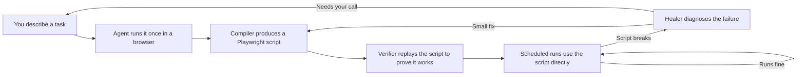

# Agent Script Compiler (Product Name TBD)

Pay the expensive, brilliant, unreliable intelligence to write and repair cheap, dumb, reliable code, and never pay it to do the same work twice.

## What this is

Most "AI agent" products put a language model in the loop every single time a task runs. That is slow, expensive, and unpredictable. It also means every run is a fresh gamble, even for work the agent already figured out yesterday.

This project takes the opposite stance. The agent is treated as a *compiler*, not a runtime. You describe a task once, the agent works through it in a real browser under instrumentation, and the output is a plain Playwright script. From that point on, the script is what actually runs on your schedule. It is fast, deterministic, and cheap. The agent only comes back into the picture when you want to author a new workflow, or when an existing script breaks because a site has changed.

Think of it as the difference between hiring a specialist to solve a problem once and write down the answer, versus paying them to re-derive the same answer every morning.

## Who it is for

Anyone who runs the same browser-based task repeatedly, cares that it keeps working, and does not want to babysit a fragile agent. Typical fits: data collection from sites without a real API, recurring reporting flows, internal tools that only expose a web UI, and any "I do this every Monday" task that a person keeps stealing back from automation because the automation kept breaking.

## How it fits together

The important thing in that diagram is the loop at the bottom right. Once a script is authored and verified, ordinary runs never touch the agent. The agent is only pulled back in when something is genuinely new or genuinely broken, and even then the healer tries to fix the smallest possible piece before asking you to weigh in.

## Status

Early stage. The design is written up in `docs/`, and implementation has not started yet. The README will grow as real pieces land.
