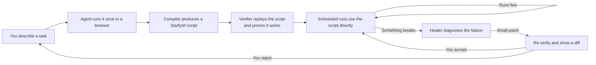

# Starfysh

A browser-automation compiler that turns one AI-recorded session into a deterministic, self-healing script. The agent authors the code once, the runtime runs it indefinitely.

> **Status at `0.1.0`.** The paragraph above is the vision. Phase 0 (the IR, compiler, runtime, and Playwright adapter) is shipped on npm. Phase 1 (recorder, verifier, healer, CLI, MCP server) is in progress. The sections below separate what you can use today from what is coming.

## What ships today

The four `@sfysh/*` packages on npm give you the deterministic middle of the pipeline: an IR schema with validators, a templated compiler, a browser-backend-agnostic runtime, and a Playwright bridge.

| Package                     | What it does                                                                                                                                                 |
| --------------------------- | ------------------------------------------------------------------------------------------------------------------------------------------------------------ |
| `@sfysh/ir`                 | JSON-Schema-first IR for Starfysh workflows, with Ajv validators and generated TypeScript types.                                                             |
| `@sfysh/compiler`           | Takes a validated IR workflow and emits deterministic TypeScript, byte-stable across runs.                                                                   |
| `@sfysh/runtime`            | The `workflow()` runner, `vault()` secret resolver, assertions, extraction helpers, and the `Page`/`Locator` interfaces that generated code targets.         |
| `@sfysh/playwright-adapter` | Casts Playwright's `Page` and `Locator` to the runtime's structural interfaces so Playwright-driven tests can run Starfysh workflows without rewriting them. |

**What this means in practice.** You can hand-author a workflow IR today following the schema in `@sfysh/ir`, compile it with `@sfysh/compiler`, and execute the result via `@sfysh/runtime` plus Playwright. That is a working, deterministic path from JSON to a running browser automation.

**What is not here yet.** The recorder that turns an agent session into IR, the verifier that proves a workflow replays cleanly, and the healer that patches broken steps when sites change all land in Phase 1. Those are the components that take Starfysh from "a well-typed Playwright toolkit" to "an automation you can actually leave running". See the [roadmap](#roadmap).

## What this grows into

Browser automation has a trust problem. Hand-written scripts break every time a site redesigns, and someone has to fix them by hand. Live AI agents cost real money on every run and still fail in confident, unexplained ways. Neither of those is something you can leave running without a person watching it.

Starfysh is aimed squarely at that gap. The pitch in one line: browser automation you can actually leave running.

The mechanism is a compiler, not a runtime. The agent works through a task once in a real browser, under instrumentation, and the output is a Starfysh script -- a typed, deterministic program that depends only on `@sfysh/runtime`. From then on, the script is what runs on your schedule. When the script eventually breaks, because sites always eventually change, a healer diagnoses the failure, patches the smallest possible piece, re-verifies against the live site, and shows you a readable diff of what changed and why. The agent is only in the loop for authoring and healing, never for ordinary runs.

**Playwright compatibility.** If you already run Playwright scripts, `@sfysh/playwright-adapter` lets you plug Playwright's page objects directly into Starfysh's runtime interfaces, so the healer and verifier work on your existing scripts without migration.

The compiler is how it works. The reliability is what it is for.

## Who it is for

Anyone who runs the same browser-based task repeatedly, cares that it keeps working, and is tired of being the person who fixes it at 3am when the vendor portal changes. Typical fits: data collection from sites without a real API, recurring reporting flows, internal tools that only expose a web UI, and any "I do this every Monday" task that a person keeps stealing back from automation because the automation kept breaking.

If your current options are "pay an agent to re-derive the same workflow every morning and hope" or "maintain a pile of brittle scripts by hand," this is aimed at you.

## How it fits together



_Shipped in `0.1.0`: step C (compiler) and step E (scheduled runtime execution, via `@sfysh/runtime` and `@sfysh/playwright-adapter`). Steps A, B, D, F, and G are Phase 1 scope._

Two things in that diagram are the whole point. First, the self-loop at `E`: ordinary runs never touch the agent, so they are fast, cheap, and predictable. Second, the path through `F` and `G`: when something breaks, you do not get a mysterious failure and a rewritten script. You get a diagnosis, the smallest possible patch, fresh evidence that it works, and a diff you can read in ten seconds before accepting.

## What we measure

Reliability only means something if it is measurable. The numbers Phase 1 tracks across every workflow and run:

- **Mean time between heals.** How long a script survives in the wild before something breaks.
- **Heal success rate.** Of failures the healer attempts, how many produce a patch that verifies.
- **False-heal rate.** Of patches that verify, how many silently do the wrong thing.
- **Time-to-heal.** Wall clock from breakage detected to patched script running again.
- **Human intervention rate.** What percentage of heals need a person to weigh in before shipping.

The intent is to report these honestly rather than selectively.

## Roadmap

### Phase 0: Foundations (shipped at `0.1.0`)

The deterministic core, published on npm. See [What ships today](#what-ships-today) for the per-package detail. The baseline (typecheck, format, 82 tests) is green and a benchmark harness runs five real-site tasks.

### Phase 1: Healer-first MVP (in progress)

The pieces that take Starfysh from "foundations" to "an automation you can actually leave running": a parser that lifts existing Playwright scripts into IR, a verifier that replays workflows against the live site to prove they still work, a healer that patches broken steps with reviewable diffs, and the CLI and MCP tooling so humans and coding agents can both drive the stack. A synthetic-drift benchmark will stress-test the healer and produce the reliability numbers the measurement section describes.

### Phase 2: Beta and polish

Private beta with real users, additional vault backends (Doppler, AWS Secrets Manager), a minimal docs site, and the public announcement.

## Longer-term direction

The healing stack at the centre of Starfysh is designed to be surface-agnostic. Browser workflows come first because they are the hardest unsolved healing surface. The architecture is kept deliberately open to extending to other surfaces with observable postconditions and cheap replay once the browser case is proven, but that is not what is being built this quarter.

## Local development

Setup instructions for picking the project up on a fresh machine. The repo is a pnpm workspace running Node 22 LTS. The same commands work on macOS, Windows, and Linux once the prerequisites are in place.

### Prerequisites

**Node 22 LTS or newer.** Verify with `node --version`. If missing:

- macOS: `brew install node@22`, or install via [fnm](https://github.com/Schniz/fnm), [Volta](https://volta.sh/), or [nvm](https://github.com/nvm-sh/nvm).
- Windows: `winget install OpenJS.NodeJS.LTS`, or download the installer from [nodejs.org](https://nodejs.org/).
- Linux: use your distro's package manager, `nvm`, or `fnm`.

**pnpm 9.x.** The version is pinned in the root `package.json` via `packageManager`. The simplest install is Corepack, which ships with Node:

```sh
corepack enable
corepack prepare pnpm@latest --activate
pnpm --version
```

#### Windows caveat: Corepack and Node in Program Files

If Node was installed to `C:\Program Files\nodejs\`, Corepack cannot write its shims there without admin rights and the enable step fails with `EPERM`. Either run an elevated PowerShell window, or install pnpm standalone to your user profile:

```powershell
Invoke-WebRequest -UseBasicParsing "https://get.pnpm.io/install.ps1" -OutFile "$env:TEMP\pnpm-install.ps1"
& "$env:TEMP\pnpm-install.ps1"
```

Open a new terminal after installation so pnpm is on your PATH.

### Clone and install

```sh
git clone https://github.com/76Trystan/starfysh.git
cd starfysh
pnpm install
```

The first install takes around 30 seconds and produces `node_modules/` and `pnpm-lock.yaml`. Both are gitignored except for the lockfile.

### Verify the baseline

Run all three before and after every change. They are the invariant the whole project builds on:

```sh
pnpm typecheck
pnpm format:check
pnpm test
```

All three must pass. If any fails on a fresh clone, something has broken that should not have.

### Common commands

| Command                               | What it does                                                                              |
| ------------------------------------- | ----------------------------------------------------------------------------------------- |
| `pnpm install`                        | Install workspace dependencies.                                                           |
| `pnpm typecheck`                      | `tsc --noEmit` across every workspace package.                                            |
| `pnpm test`                           | Vitest run across every workspace package.                                                |
| `pnpm test:watch`                     | Vitest in watch mode for the active package.                                              |
| `pnpm format`                         | Apply Prettier formatting in place.                                                       |
| `pnpm format:check`                   | Verify formatting without writing.                                                        |
| `pnpm --filter @sfysh/ir regen-types` | Regenerate `packages/ir/src/types.ts` from the JSON schemas. Run after any schema change. |
| `pnpm --filter @sfysh/<pkg> test`     | Run tests for a single package.                                                           |

### Editor setup

Any TypeScript-aware editor works. VS Code picks up `tsconfig.base.json` and the per-package `tsconfig.json` files automatically. Recommended extensions: Prettier, ESLint (when it lands), and the official JSON Schema extension so workflow files get live validation against the schema (triggered by the `$schema` pointer at the top of each example).

### Where to start contributing

1. Read [`CONTRIBUTING.md`](./CONTRIBUTING.md) for conventions and the baseline-green requirement.
2. Pick an open issue or propose a change.
3. Make the change. Keep `pnpm typecheck + format:check + test` green on every commit.

## Documentation

See [`docs/reference/ir-schema.md`](./docs/reference/ir-schema.md) for the IR schema reference. Package-level docs live under each `packages/<name>/README.md`.
