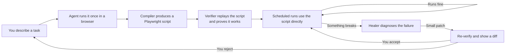

# Agent Script Compiler (Product Name TBD)

Pay the expensive, brilliant, unreliable intelligence to write and repair cheap, dumb, reliable code, and never pay it to do the same work twice.

## What this is

Browser automation has a trust problem. Hand-written Playwright scripts break every time a site redesigns and someone has to fix them by hand. Live AI agents cost real money on every run and still fail in confident, unexplained ways. Neither of those is something you can leave running without a person watching it.

This project is aimed squarely at that gap. The pitch in one line: browser automation you can actually leave running.

The mechanism is a compiler, not a runtime. The agent works through a task once in a real browser, under instrumentation, and the output is a plain Playwright script. From then on, the script is what runs on your schedule. When the script eventually breaks, because sites always eventually change, a healer diagnoses the failure, patches the smallest possible piece, re-verifies against the live site, and shows you a readable diff of what changed and why. The agent is only in the loop for authoring and healing, never for ordinary runs.

The compiler is how it works. The reliability is what it is for.

## Who it is for

Anyone who runs the same browser-based task repeatedly, cares that it keeps working, and is tired of being the person who fixes it at 3am when the vendor portal changes. Typical fits: data collection from sites without a real API, recurring reporting flows, internal tools that only expose a web UI, and any "I do this every Monday" task that a person keeps stealing back from automation because the automation kept breaking.

If your current options are "pay an agent to re-derive the same workflow every morning and hope" or "maintain a pile of brittle scripts by hand," this is aimed at you.

## How it fits together

Two things in that diagram are the whole point. First, the self-loop at `E`: ordinary runs never touch the agent, so they are fast, cheap, and predictable. Second, the path through `F` and `G`: when something breaks, you do not get a mysterious failure and a rewritten script. You get a diagnosis, the smallest possible patch, fresh evidence that it works, and a diff you can read in ten seconds before accepting.

## What we measure

Reliability only means something if it is measurable. The numbers we care about, and intend to publish honestly, are:

- **Mean time between heals.** How long a script survives in the wild before something breaks.
- **Heal success rate.** Of failures the healer attempts, how many produce a patch that verifies.
- **False-heal rate.** Of patches that verify, how many silently do the wrong thing. This is the number that matters most, and the one nobody in this space wants to talk about.
- **Time-to-heal.** Wall clock from breakage detected to patched script running again.
- **Human intervention rate.** What percentage of heals need a person to weigh in before shipping.

If those numbers are good, this is a real product. If they are not, no amount of architecture around them fixes it.

## Status

Phase 0 of the MVP build is in progress. The IR schema (`packages/ir`) is drafted, validated, and type-safe; the compiler, verifier, healer, CLI, benchmark, and MCP server are all still to come. Current build state lives in [`docs/planning/ToDo.md`](./docs/planning/ToDo.md).

Order of landing, in priority: compiler + runtime + benchmark harness (Phase 0), then parser + verifier + healer + CLI + MCP server (Phase 1). The healer is the headline feature. Published false-heal rate is the headline metric.

## Documentation map

| Where                                                                                          | What                                                                                                                               |
| ---------------------------------------------------------------------------------------------- | ---------------------------------------------------------------------------------------------------------------------------------- |
| [`docs/planning/ToDo.md`](./docs/planning/ToDo.md)                                             | Current build state and the full MVP plan, phased. Start here if you are picking up work.                                          |
| [`docs/scope/`](./docs/scope/)                                                                 | Internal planning notes.                         |
| [`docs/architecture/decisions/`](./docs/architecture/decisions/)                               | Architecture Decision Records. Every load-bearing design choice is numbered and dated here.                                        |
| [`docs/development/gotchas.md`](./docs/development/gotchas.md)                                 | Issues hit, root causes, and fixes. Read this before re-debugging anything strange.                                                |
| [`docs/REMOVED.pdf`](./docs/REMOVED.pdf) | Internal planning notes. |
| [`CLAUDE.md`](./CLAUDE.md)                                                                     | Local-only operating manual.                                    |
